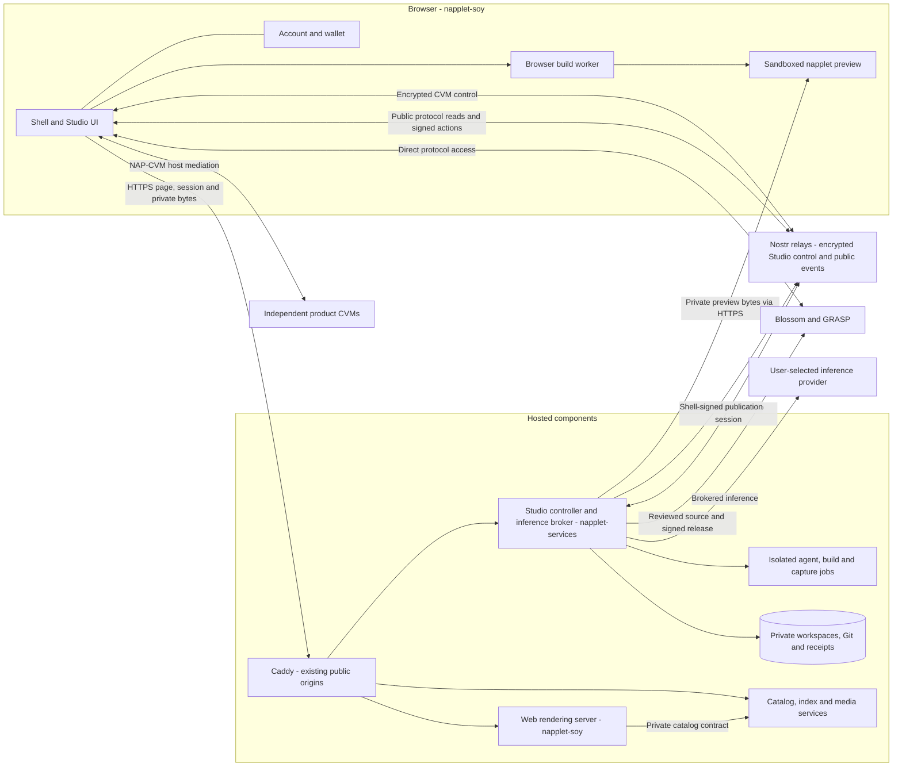

# Soytec architecture and service extraction

**Status: proposal for maintainer review, 6 November 2026.** The `napplet-services` repository is being bootstrapped for this work. No runtime code, production state or deployment is moved by this document. Repository boundaries and the migration sequence below are proposed; they are not a description of an already completed extraction.

## Purpose

Let the shell, hosted services and soyLI evolve and ship independently while keeping one coherent creation experience. A shell UI change should not rebuild or restart Studio workers, Git hosting, storage and relays. A hosted worker update should not require a new shell release.

The extraction should preserve the product's existing protocol boundaries: the browser remains a Nostr client, the shell owns the user's account and signatures, and hosted Studio provides private workspaces and isolated execution. It is not a prerequisite for replacing the VPS or introducing distributed workers.

## What exists today

These are source snapshots, not assertions about the exact production release. Before extraction, reconcile deployed fixes and open PRs with the chosen source baseline.

| Repository | Verified source state | Remaining boundary work |
| --- | --- | --- |
| [napplet-soy](https://github.com/soytec/napplet-soy/tree/e70792cc85aeaf35238084ac5a50527a4317895b) | Shell, browser Studio, hosted Studio, backend services and a CLI copy share one checkout. | Studio imports CLI internals; web server functions import backend data/storage code. |
| [soyli](https://github.com/soytec/soyli/tree/a50f9946f9ec1cdefe589f3e60f2d48895347c09) | Standalone CLI source has been extracted and consolidated under `src/`. Its README describes building without the original checkout. | It is a private package manifest with internal `#src/*` aliases, not a published integration SDK. Release-channel migration and consumers' cutover remain distinct work. |
| [napplet-services](https://github.com/soytec/napplet-services) | Repository bootstrap for the proposed extraction. | No hosted runtime has been moved yet. |

The standalone [soyLI migration notes](https://github.com/soytec/soyli/blob/a50f9946f9ec1cdefe589f3e60f2d48895347c09/docs/MIGRATION.md) still describe installer/updater compatibility with the old release channel and outstanding standalone distribution work. Those notes predate the latest internal source reorganization. Source extraction does not establish that a new downloadable release or SDK exists.

Concrete coupling to remove includes [Studio's CLI imports](https://github.com/soytec/napplet-soy/blob/e70792cc85aeaf35238084ac5a50527a4317895b/apps/studio/studio.ts), [catalog server functions](https://github.com/soytec/napplet-soy/blob/e70792cc85aeaf35238084ac5a50527a4317895b/apps/web/src/lib/catalog.functions.ts), and browser imports of [backend public models](https://github.com/soytec/napplet-soy/blob/e70792cc85aeaf35238084ac5a50527a4317895b/packages/backend/src/public-model.ts).

## Repository responsibilities

| Home | Owns | Boundary |
| --- | --- | --- |
| `soytec/napplet-soy` | Website and Studio UI, account/signing context, wallet UI, browser protocol clients, browser compiler worker, and the small web server needed for rendering. | No hosted job execution or direct backend database access after cutover. Server-side rendering remains server code in this repo. |
| `soytec/napplet-services` | Hosted Studio controller, workspace/Git persistence, job queue, inference broker, isolated worker/capture integration; catalog/indexing, media cache and operator service endpoints. | Several independently deployable processes in one repo. Public APIs and wire contracts are explicit. |
| `soytec/soyli` | Local creator workflow, guidance, checks, build, preview, publishing and collaboration tools; reusable creator logic where a supported interface is agreed. | Consumers use released artifacts or explicit versioned exports, never another checkout's private source paths. |
| Existing private product repos | Proprietary CVM business logic, prompts and product-specific deployment. | Public service descriptions and standard CVM protocols can expose capabilities without publishing implementation or credentials. |

The services repo should also own the operator packaging and configuration templates for our relay, Blossom, GRASP, public CVM and TURN infrastructure. This does not mean rewriting upstream services or releasing them together. Their binaries/images, versions, state and restart policies remain independent.

This proposal does not create a fourth shared-runtime repo. Before moving any shared module, decide its canonical owner and check whether the upstream runtime already supplies it. The exact reusable soyLI exports require agreement with its maintainer; `#src/*` is not that public contract.

## Runtime layout

Public protocol services may run on our infrastructure or elsewhere. The browser's protocol client selects them according to its configuration and shell policy. The catalog is an accelerator and server-rendering source; it must not become the authority for signed Nostr data or a requirement to play an otherwise valid unindexed napplet.

### Browser builds and server builds

Extracting services does not change the meaning of the build toggle. This table preserves the [documented hosted Studio boundary](https://github.com/soytec/napplet-soy/blob/e70792cc85aeaf35238084ac5a50527a4317895b/docs/STUDIO-HOSTING.md).

| Work | Browser build | Server build |
| --- | --- | --- |
| Chat, model choice, account and publication signatures | Browser shell | Browser shell |
| Agent and its file/tool operations | Isolated server job | Isolated server job |
| TypeScript checking and HTML bundling | Browser Web Worker for supported projects; requires the tab to remain open | Isolated server job with installed toolchain profile |
| Authoritative draft files, Git history and operation receipts | Private server workspace | Private server workspace |
| Playable preview | Browser sandbox | Browser sandbox |
| Release validation and gameplay capture | Isolated server check/capture job | Isolated server check/capture job |
| Hosted source push and publication | Controller coordinates; shell signs reviewed events | Same |

The experimental browser-Git path is separate work. This extraction does not make it authoritative for hosted source or silently migrate existing drafts. Dependency-free HTML imports should retain their existing validation path rather than acquiring a compiler requirement.

## Contracts between repositories

1. **Studio control and transfers:** retain encrypted MCP/ContextVM control over Nostr. Keep HTTPS for the existing NIP-98 session bootstrap and account-bound private bytes/preview transport. Preserve canonical signed URLs, session revocation, exact-event signing and same-origin behavior behind Caddy. Moving code must not introduce a second account or publishing identity.
2. **Catalog and server rendering:** define a small private read interface for the web server to consume catalog data. Database schema and cache internals belong to services. Browser protocol reads stay direct; do not replace them with a general REST proxy. Existing public compatibility paths remain available where required.
3. **Types and validation:** services owns versioned wire schemas and browser-safe client types for its interfaces. Move browser-facing models out of backend implementation imports. No filesystem, database, Bun or server credential dependency may enter these exports. Test schemas at both ends rather than relying on TypeScript types alone.
4. **Creator and sandbox logic:** use a pinned soyLI executable and its structured results for supported process-level operations. Where the shell or workers need embedded runtime, preview or validation logic, agree a small supported export/artifact with the canonical owner. Preserve one implementation of shared protocol validation; neither duplicate it across repos nor depend on soyLI's private aliases.
5. **Compatibility:** add a capability/version handshake and fixtures for the current and previous supported client/service pair. An older open browser tab must either remain supported or receive an actionable upgrade response before a mutation starts. Retrying an uncertain mutation must not repeat inference, publication or payment.

Contract and source-of-truth decisions should be implemented and exercised inside the existing checkout before files move. Extracting directories first would leave hidden dependencies and make failures harder to attribute.

## Deployment proposal

Keep the existing VPS, Caddy, process supervision and Docker isolation during the first extraction. The [current deployment implementation](https://github.com/soytec/napplet-soy/blob/e70792cc85aeaf35238084ac5a50527a4317895b/scripts/deploy-remote.sh) is the migration input, not a reason to require every future release to rebuild the entire stack.

| Deployment unit | Artifact | Activation policy |
| --- | --- | --- |
| Web rendering server and static browser assets | Immutable web release | Deploy independently after contract checks. |
| Studio controller and inference broker | Versioned service release with runtime dependencies | Drain active work and preserve operation receipts before replacing the single controller. |
| Agent/build/capture worker profiles | Images pinned by digest, with exact soyLI/toolchain versions | Validate a profile before assigning it to new jobs; retain the previous compatible image. |
| Catalog/index/media services | Service artifacts and explicit data-schema version | Independent activation with migration and health checks. |
| Relay, Blossom, GRASP, public CVM and TURN | Individually pinned upstream/custom artifacts | Restart only when that component or its configuration changes. |

Build release artifacts in CI, then promote the same tested artifacts to staging and production through an operator-triggered deployment. Keep deployment scripts with the owning component and a reviewed deployment manifest in `napplet-services` that records web, service, worker, soyLI, contract and state-schema versions. Store only templates and references publicly; secrets remain provisioned on the host.

The existing legacy-CPU profile is an acceptance requirement. A successful Linux amd64 build does not prove it will run on the current VPS. Test the exact controller and worker artifacts on the supported CPU profile, including child processes and recovery. A newer standalone soyLI build runtime must not silently replace that compatibility profile.

A UI release should need no Studio restart. A controller release should not run two controllers against the same mutable workspace. Distributed execution, worker discovery and cross-host scheduling are later decisions; separating repositories alone does not add capacity or solve concurrency.

## State, authority and rollback

- Keep persistent data outside release directories: draft metadata and Git repos, job receipts, encrypted provider credentials and their master key, service identities, relay data, Blossom objects, GRASP repos, moderation/configuration state and caches. Classify which stores are reconstructible; do not assume every backend database is a disposable index.
- Assign one authoritative owner to each mutable store. The final web deployment has no direct catalog SQLite mount or Studio workspace access. Preserve current workspace IDs, ownership, Git bindings, source revisions and public URLs.
- Carry forward session isolation, credential handling, container restrictions and private transfer checks. Staging uses separate state and identities. It must not borrow production signing/payment credentials or replay live mutations.
- Preserve the selected NIP-5D contract and upstream pins in the [protocol documentation](https://github.com/soytec/napplet-soy/blob/e70792cc85aeaf35238084ac5a50527a4317895b/docs/PROTOCOL.md). Treat every publisher equally; optional source and presentation metadata must not become playback requirements.
- Use additive schema changes during the compatibility window. Keep the previous artifacts and a tested state backup. Roll back code only when the previous version can read the current state; otherwise use the documented state recovery procedure. Verify restore before a destructive migration.
- Expose health and version information per service and retain operation IDs and actionable, redacted diagnostics across boundaries. Signing, capture, source import and publication failures must remain distinguishable.

## Migration sequence and acceptance

| Step | Deliverable | Exit condition |
| --- | --- | --- |
| 1. Review ownership and baseline | This org document plus an extraction inventory: modules, direct imports, service entrypoints, state and deployed/open-PR differences. | Maintainers agree the boundaries and source baseline; deployed fixes are accounted for. |
| 2. Define the seams | Versioned contracts, supported soyLI consumption, and independent service entrypoints in the current repo. | Browser exports contain no server dependencies; contract fixtures pass without sharing implementation imports. |
| 3. Establish artifacts | CI builds web, services and worker profiles with pinned dependencies; agree soyLI release/update compatibility. | Clean builds need no sibling source checkout. Exact artifacts pass target-CPU and package/distribution checks, including applicable Nix checks. |
| 4. Extract services | Move the agreed paths with an explicit path map; preserve authorship/history where practical, licenses and provenance. | Source and fixtures agree across repos; old duplicate implementations are retired only after consumers switch. |
| 5. Stage the cutover | Proxy routes, isolated staging state, deployment manifest, backup/restore and rollback rehearsal. | Both browser/server build paths and old/new client compatibility pass; no changes to public URL or account semantics. |
| 6. Activate and verify | Independently deploy the approved components, draining Studio where required. | Draft/Git/binding inventories survive; health, preview, remix, proposal/review/merge, publication and recovery checks pass. |

Acceptance must cover Git-backed and source-less remixes, expired/disconnected accounts, cancelled and interrupted jobs, capture errors and an already-open older browser client. Use isolated protocol fixtures for signing/publication/payment tests; a deployment check must not spend money or publish user work. Prove at least one web-only deployment and one service-only deployment before calling release independence complete.

Do not infer a successful migration from passing unit tests or repository creation alone. Record separately what has been implemented, verified and deployed.

## Maintainer decisions requested

| Question | Proposed starting point |
| --- | --- |
| How broad is the first extraction? | One services repo containing distinct Studio and catalog entrypoints. Move protocol infrastructure packaging there as it is separated; keep independent deployment units. |
| How should shell and services consume soyLI? | Released CLI artifacts for process operations; a deliberately small, versioned reusable API/artifact where embedding is necessary. Agree ownership with the soyLI maintainer before moving shared code. |
| Where should service schemas live? | In `napplet-services`, published as browser-safe contracts/client exports. No new shared repo initially. |
| How should releases reach production? | CI-built immutable artifacts, isolated staging, explicit operator promotion and rollback on the existing host. |
| Who maintains services and may deploy it? | Assign repository maintainers and production deploy access explicitly. Existing org/repo roles remain unchanged by this proposal; neither role automatically implies the other. |

Review discussion belongs on the architecture PR. Once agreed, retain this document as the org-level map and keep component-specific operations and implemented limits in their owning repositories.
